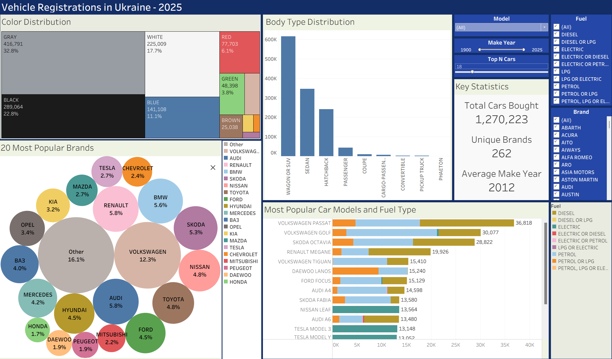

# Vehicle Registrations in Ukraine - 2025

## Overview

This project explores vehicle registration data in Ukraine for 2025, focusing on purchase-related operations involving passenger cars.

The goal is to identify the most popular car brands and models, analyze fuel type preferences, vehicle colors, manufacturing years, and other characteristics of purchased vehicles.

The analysis was performed using Python for data cleaning and Tableau for data visualization.

## Dataset

The dataset was obtained from the [Ukrainian Open Data Portal](https://data.gov.ua/dataset/06779371-308f-42d7-895e-5a39833375f0/resource/b7e72d22-55f5-4545-87dc-94e6c8ee03ef).

- **Original dataset:** 2,229,904 records
- **Cleaned dataset:** 1,270,315 records
- **Period:** 2025
- **Scope:** Purchase-related operations involving passenger cars

The original dataset contains **different** types of vehicle registration operations. The analysis focuses only on operations related to vehicle **purchases** and ownership transfers.

## Project Workflow

1. **Data Collection** — Obtained the vehicle registration dataset from the Ukrainian Open Data Portal.
2. **Data Cleaning** — Used Python and Pandas to remove unnecessary columns, filter records, and prepare the data for analysis.
3. **Data Analysis** — Explored vehicle brands, models, body types, fuel types, colors, and manufacturing years.
4. **Data Visualization** — Created an interactive Tableau dashboard to present the results.

## Data Cleaning

Data preparation was performed in `python/cleaning.ipynb` using Pandas.

The main steps included:

- Removing unused columns.
- Converting registration dates to datetime format.
- Filtering passenger cars only.
- Keeping selected passenger car body types.
- Standardizing KOATUU geographic codes into 10-character strings.
- Filtering records to retain only purchase-related registration operations.
- Saving the cleaned dataset as a CSV file.

After cleaning, the dataset contained **1,270,315 records**.

## Tableau Dashboard

**[View Interactive Dashboard on Tableau Public](https://public.tableau.com/views/Dashboard_17933735043400/Dashboard?:language=en-US&publish=yes&:display_count=n&:origin=viz_share_link)**



The dashboard includes the following visualizations and KPIs:

- **Total Cars Bought** — Number of purchase-related vehicle operations.
- **Unique Brands** — Number of distinct car brands.
- **Average Vehicle Year** — Average manufacturing year of the vehicles.
- **Color Distribution** — Distribution of vehicles by color.
- **Brand Popularity** — Comparison of the most popular car brands.
- **Body Type Distribution** — Distribution of vehicles by body type.
- **Most Popular Car Models and Their Fuel Type** — Popular car models and their fuel type.

The dashboard also supports interactive filtering, allowing users to explore the data by selecting different brands, body types, and other categories.

## Key Findings

### General Statistics

- **1,270,223** vehicle purchase operations are displayed in the dashboard.
- **262** different car brands are represented.
- The average manufacturing year is **2012**.
- Grey is the most common vehicle color.

### Most Popular Brands and Models

- Volkswagen is the most popular brand, accounting for **12.3%** of all records.
- Audi ranks second with **5.8%**, less than half of Volkswagen's share.
- The three most popular models are:
  1. Volkswagen Passat
  2. Volkswagen Golf
  3. Skoda Octavia

### Vehicle Age

As of 2025:
- Approximately **247,000** vehicles were up to 5 years old.
- Approximately **545,000** vehicles were more than 15 years old.

### Fuel Type Preferences

The dataset contains approximately:

- **334,000** diesel vehicles.
- **143,000** fully electric vehicles.
- **738,000** petrol and petrol + LPG vehicles.
- **41,000** petrol hybrids.

Volkswagen is the most represented brand among both petrol and diesel vehicles:

- **Petrol:** Volkswagen (12.5%), Audi (7.5%), BMW (6.7%).
- **Diesel:** Volkswagen (18.6%), Renault (13.1%), Mercedes-Benz (8.6%).

### Hybrid Vehicles

Toyota and Lexus have a particularly strong presence in the petrol hybrid segment:

- Toyota accounts for **34.9%**.
- Lexus accounts for **6.9%**.
- Together, they represent **41.8%** of petrol hybrid vehicles.

Ford ranks second among individual brands with 8.5%.

### Electric Vehicles

- Nissan Leaf is the most popular fully electric model, followed closely by Tesla Model 3 and Tesla Model Y.
- Despite that, Tesla leads among electric vehicle brands with **23.6%** of the segment.
- Nissan follows with **10.4%**, and Volkswagen with **9.7%**.
- Out of approximately 15,000 electric Nissan vehicles, around 13,500 are Nissan Leaf models.

### Popular Models by Body Type

- **Crossover:** Volkswagen Tiguan.
- **Wagon:** Volkswagen Passat.
- **Sedan:** Volkswagen Passat.
- **Hatchback:** Volkswagen Golf.

## Data Limitations

The original dataset does not provide a separate body type category for SUVs and crossovers. These vehicles are included in the `УНІВЕРСАЛ` category.

For visualization purposes, this category was renamed to **Wagon or SUV** in Tableau. This is a presentation-level adjustment and does not represent a verified classification of every vehicle.

Additionally, 92 records with missing model values were excluded from the dashboard's `Total Cars Bought` KPI. Therefore, the KPI shows 1,270,223 records, while the cleaned dataset contains 1,270,315 rows.

## Repository Structure

```text
vehicle-registrations-ukraine-2025/
│
├── data/
│   └── (CSV files excluded from Git)
│
├── python/
│   └── cleaning.ipynb
│
├── screenshots/
│   └── Dashboard.png
│
├── tableau/
│   ├── Dashboard.twb
│   └── Vehicle-Registrations-Ukraine-2025.twbx
│
├── .gitignore
└── README.md
```

## How to Use

### View the Dashboard

1. Open the [Tableau Public dashboard](https://public.tableau.com/views/Dashboard_17933735043400/Dashboard?:language=en-US&publish=yes&:display_count=n&:origin=viz_share_link) (if the dashboard doesn't display correctly, try viewing it in full-screen mode).

Alternatively, download `Vehicle-Registrations-Ukraine-2025.twbx` from the `tableau` folder and open it in Tableau Desktop.

The packaged workbook includes a data extract, so the original CSV files are not required to view the dashboard.

### Reproduce Data Cleaning

1. Download the original CSV dataset from the [Ukrainian Open Data Portal](https://data.gov.ua/dataset/06779371-308f-42d7-895e-5a39833375f0/resource/b7e72d22-55f5-4545-87dc-94e6c8ee03ef).
2. Place `reestrtz31.12.2025.csv` in the `data` folder.
3. Open `python/cleaning.ipynb` and run the notebook.

The notebook will generate the cleaned CSV file in the `data` folder.

## Tools & Technologies

- **Python** — Data processing and cleaning.
- **Pandas** — Data manipulation and transformation.
- **Jupyter Notebook** — Data cleaning workflow.
- **Tableau Public** — Data visualization and interactive dashboard creation.